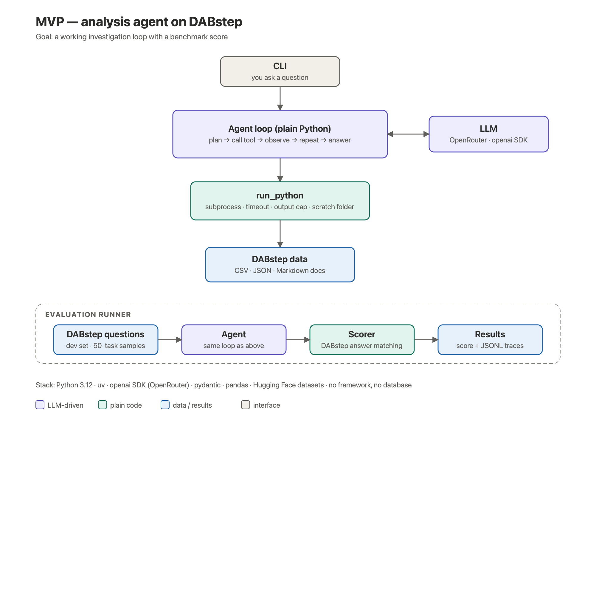
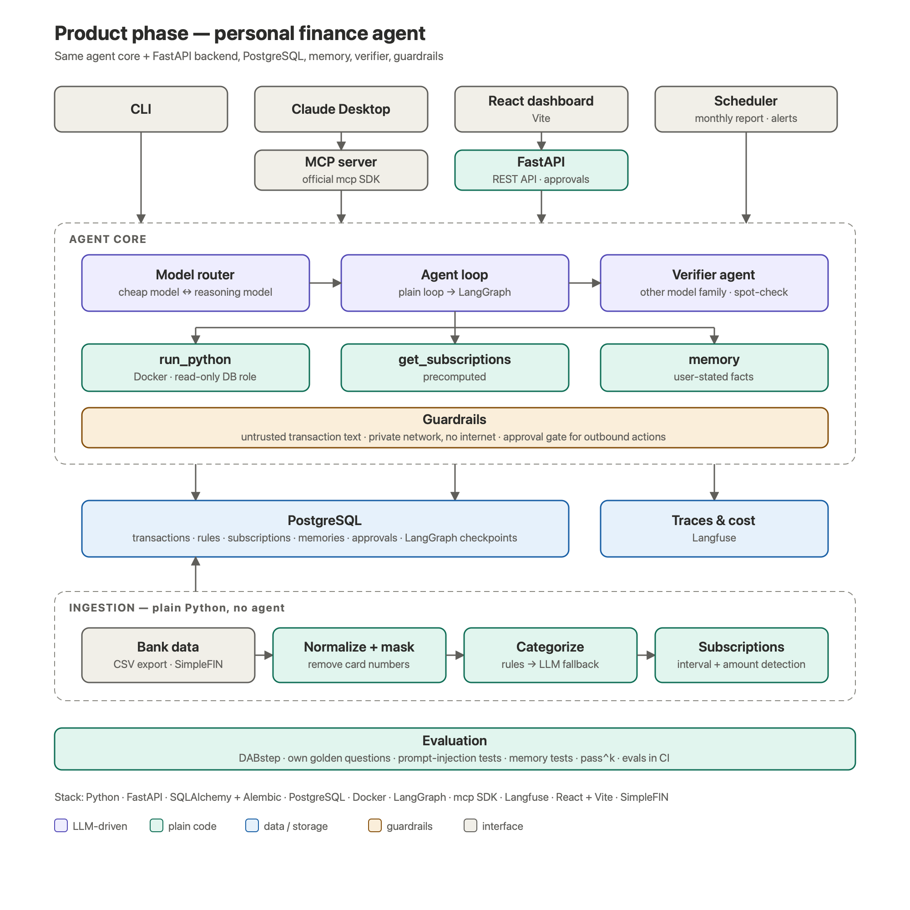

# Finance Agent: project plan

Written 2026-10-08. Name is a placeholder.

## Goal

A data analysis agent that answers open-ended questions about spending ("Why did I spend $600 more
in March?") by writing and running code step by step. It is measured on a public benchmark
(DABstep) and then used daily as a personal finance app that replaces a paid Rocket Money
subscription.

Purpose: an agentic engineering project for the resume (AI engineer roles). It replaces the
Distributed Fraud Detection Pipeline project.

## What is agentic and what is not

| Feature | Built as | Why |
|---|---|---|
| "Why did I spend more in March?" | Agent | The next step depends on what the last one showed |
| "Can I afford a $2,000 trip in December?" | Agent | Several estimates plus judgment about assumptions |
| Monthly report with explanations | Agent (scheduled) | Picks what's worth reporting |
| Categorizing transactions | Rules, LLM only for unknown merchants | Mostly a lookup |
| Finding subscriptions and price increases | Plain code | A fixed algorithm (same merchant, regular interval, similar amount) |

## Phases

### Phase 1: MVP (Python only)

An investigation loop with a DABstep score. No database, no framework, no UI.

- **Agent loop:** plain Python, about 100 lines: plan → call tool → observe → repeat → answer.
- **LLM:** OpenRouter through the `openai` SDK. Develop with a cheap model.
- **One tool, `run_python`:** runs the model's code in a fresh subprocess with a timeout, an
  output cap (about 2,000 characters, and the model is told when output was cut), and a shared
  scratch folder for results worth keeping between steps. pandas is installed; DuckDB optionally,
  for SQL over DataFrames. The subprocess starts in the scratch folder with a minimal environment
  (no API keys), because model-written code runs directly on the laptop in phase 1.
- **Data:** DABstep files (~24 MB: payments CSV, fee rules JSON, merchant data, 22 KB manual).
- **Prompt:** the manual goes into the system prompt (cached), not read in chunks through the
  output cap. Each question's answer guidelines are passed through word for word: wrong
  formatting fails a correct analysis.
- **Evaluation runner:** DABstep questions → agent → official scorer (`scorer.py` from the
  leaderboard Space) → score + JSONL traces of every step.
- **Done when:** a baseline on the 10 dev tasks (each run 3–5 times) and one leaderboard
  submission, traces of the failures, and one measured improvement.

### Phase 2: product (direct extension of the MVP)

- **Backend:** FastAPI in the same codebase, SQLAlchemy + Alembic, PostgreSQL.
- **Ingestion (plain Python):** card CSV exports, later SimpleFIN Bridge ($15/year) → normalize →
  remove card numbers → categorize (rules, LLM fallback) → detect subscriptions and price changes.
- **Sandbox moves into Docker** before real bank data: private Docker network that reaches only
  Postgres (no internet), read-only database role, memory and CPU limits.
- **Interfaces:** MCP server (official `mcp` SDK) for asking questions from Claude Desktop; React +
  Vite dashboard for charts, subscriptions and approvals; CLI; scheduler for the monthly report
  and alerts.
- **LangGraph:** port the plain loop and compare both on DABstep (accuracy, cost, lines of code).
- **Verifier agent, memory, guardrails, Langfuse:** see decisions below. Each is kept only if
  measured to help.

### Optional later

- Public demo with **synthetic data only**: Next.js + Auth.js in front of FastAPI for login and
  sessions. Never deploy real bank data.
- DAB (UC Berkeley Data Agent Benchmark, 2026) as a second benchmark or a public leaderboard
  entry.

## Decisions

| Topic | Decision | Why |
|---|---|---|
| Benchmark | DABstep (Adyen + Hugging Face): 450 questions on payments data, 72 easy / 378 hard, automatic scoring, public leaderboard. Only 10 dev tasks have public answers (they are copies of test tasks); the other 440 are scored only by submission | Finance domain matches the product; hidden answers prevent tuning to the test |
| Second benchmark | None in phase 1. DAB skipped (multi-database, ~7 GB setup). InsightBench (find and explain insights, LLM-judged) is a candidate for phase 2 | 10 dev tasks + leaderboard is enough to steer the MVP; InsightBench tests the "explain my spending" skill DABstep doesn't |
| Own labeled DABstep questions | Not now | Hard answers depend on reading the manual's fee rules; a self-made answer key could be wrong in ways we can't see. Add only if 10 dev tasks + leaderboard steer too slowly |
| Learned helper library (what the top entries do) | After the plain baseline, as one measured change | Top entries (~90% hard) build tested reusable functions (fee matching etc.) from the dev answers and give a small model only their signatures. Questions are templated, so this works. Same idea fits phase 2: verified spending functions the agent calls |
| Agent framework | Plain loop first, LangGraph in phase 2 | Learn the loop by hand, then use LangGraph where it saves work (checkpoints, approvals, memory), and measure both |
| Sandbox | Stateless subprocess + scratch folder; Docker before real data | Simple and visible state; switch to a persistent kernel only if traces show wasted rework. Transaction text is written by outsiders, so code must run sealed off before real data |
| Data access | One `run_python` tool (pandas, optional DuckDB); no separate SQL tool | Fewer tools, fewer wrong choices |
| Database | PostgreSQL (phase 2) | Industry standard; also holds memory and LangGraph checkpoints; read-only role for the agent |
| Backend | FastAPI, same codebase | Python is required for the AI side anyway; one language. .NET dropped (work experience already covers it); Django's admin panel not needed (SQLAdmin or a DB GUI if wanted) |
| Frontend | React + Vite | A private dashboard needs no server rendering; Next.js only for the optional public demo |
| Models | APIs only, via OpenRouter. Dev default: Nemotron 3 Super (free; NVIDIA logs prompts, fine for public DABstep data). Phase 2 with real data: only paid providers that neither retain nor train on prompts | Local models need more than the available 16 GB of memory to be useful; free endpoints log or train on inputs |
| Verifier (recommended, confirm when built) | Free sanity rules in code first; then a spot-check verifier from a different model family that recomputes only the headline number without seeing the analyst's work; at most 1 retry, else mark the answer unverified | Catches wrong answers; kept only if fixes outnumber breaks for the cost |
| Memory (phase 2, not MVP) | Data corrections ("Costco is groceries", merchant aliases) become categorization rules run by plain code. A small `memories` table holds facts the user states (budgets, pay dates, report preferences), all loaded into each conversation | Rules are exact and free; a few dozen facts need no search |
| Memory safety | Saved only from the user's own messages; agent guesses need confirmation; never from transaction text; editable with history kept; off during benchmark runs | Prevents memory poisoning; learning during the benchmark would be learning from the exam |
| CI | A small DABstep subset runs in GitHub Actions on every change | "Continuous evaluation" is a common job requirement |

## Evaluation

- **DABstep:** accuracy on the 10 dev tasks (3–5 runs each) during development; a full
  450-task run and a leaderboard submission at milestones (baseline, then each kept change).
  Submissions are public (answers and per-task scores) and each organisation + agent name can be
  submitted once; there is no rate limit in the Space code. Other entries' public per-task
  scores are not used to tune the agent.
- **Reliability:** pass^k on the 10 dev tasks (run each several times; does it succeed every time).
- **Per run:** tool-call errors, steps per task, tokens, cost, time.
- **Phase 2 additions:** own golden questions on synthetic transactions, prompt-injection tests
  (transaction text trying to steer the agent), memory tests (~15 cross-session cases plus
  poisoning cases), verifier fixes vs breaks.
- Every change is measured before it is kept; results are logged in `docs/EVALUATION.md`.

## Costs (OpenRouter prices on 2026-10-08)

Assumption to replace with measured numbers after the first 10 tasks: ~80M input and ~3M output
tokens per full 450-task run, ~80% of input cached.

| Model | Full run (cached) |
|---|---|
| Claude Haiku 5.5 | ~$4 |
| DeepSeek V4 Flash (price looked promotional; recheck) | ~$5 |
| GPT-5.6 Luna | ~$8 |
| Gemini 3.8 Flash | ~$28 |
| Claude Sonnet 5.5 / GPT-5.6 Sol | ~$74 |

Check that caching actually happens (OpenRouter needs `cache_control` marks for Claude models);
without it, input cost is ~3–5× higher than these estimates.

Development runs on the free Nemotron 3 Super: $0, but free models are limited per day (about
1,000 requests/day once $10 of credits are bought; recheck), and one 10-task × 3-run eval is
~300 requests. A full 450-task run on a free model may span days.

Plan: develop on a cheap model; compare 2–3 cheap models on the 10 dev tasks, then one full run each for the best 1–2 (~$4–8 each); one
strong-model full run only when stable. Whole project ~$25–50, plus ~$75 for an optional
strong-model run. Set a spending limit on the OpenRouter key. Reasoning models can triple output
cost.

## First steps

1. `uv init`, Python 3.14, `.env` with the OpenRouter key (gitignored).
2. Download DABstep (`data/context/*`, `data/tasks/dev.jsonl`, `data/tasks/all.jsonl`) and the
   official `scorer.py`; read the task format and the 10 dev tasks.
3. Write `run_python` (subprocess, timeout, output cap, scratch folder) with a small check that
   fails if the timeout or the cap breaks.
4. Write the agent loop and run it on 1 dev task by hand; read the trace.
5. Evaluation runner over the 10 dev tasks (k runs each); record baseline score, tokens and
   cost; full run and first leaderboard submission.
6. Error analysis on the failures; one fix; measure it.
